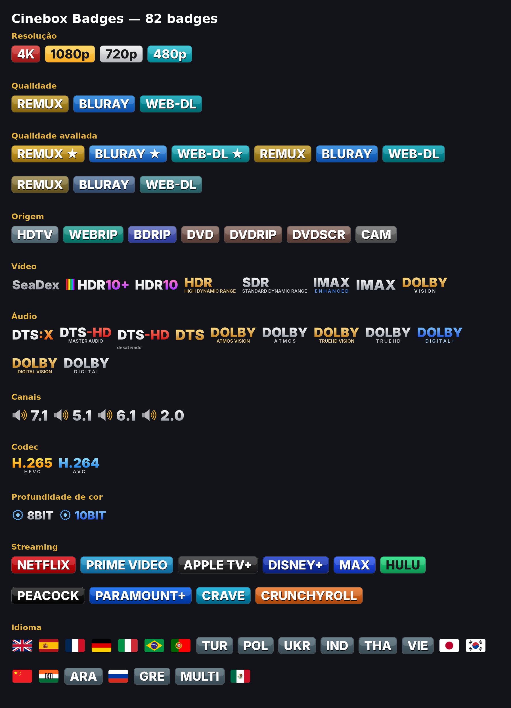

# Cinebox Badges

Packs de badges para o **Cinebox** (addon Kodi) e para o **CineboxPRO** (APK), no formato JSON compatível com Badger/Nuvio.



## Pack Cinebox (principal)

Este pack tem 82 badges em PNG, com 81 deles ativos por padrão. As imagens ficam neste repositório, na pasta `cinebox/`, e por isso nada depende de servidores externos.

```text
https://raw.githubusercontent.com/TrainAgain2/cinebox-badges/main/cinebox.json
```

### Como usar

- **Cinebox (Kodi):** abra **Definições → Interface → Pacote de badges → Link do JSON (Nuvio)** e cole a URL acima.
- **CineboxPRO (APK):** abra **Configurações → Badges**, cole a URL acima e toque em **SALVAR**.

### Conteúdo

| Grupo | Badges |
|---|---|
| Resolução | 4K, 1080p, 720p, 480p |
| Qualidade | Remux, BluRay, WebDL |
| Qualidade avaliada | Best / Good / OK, cada um para Remux, BluRay e WebDL (classificação por ★) |
| Origem | HDTV, WebRip, BDrip, DVD, DVDrip, DVDscr, CAM |
| Vídeo | SeaDex, HDR10+, HDR10, HDR, SDR, IMAX Enhanced, IMAX, Dolby Vision |
| Áudio | DTS:X, DTS-HD MA, DTS-HD (desativado), DTS, Atmos, Atmos+DV, TrueHD, TrueHD+DV, DD+, DD+DV, DD |
| Canais | 7.1, 6.1, 5.1, 2.0 |
| Codec | H265 HEVC, H264 AVC |
| Profundidade de cor | 8 bit, 10 bit |
| Streaming | Netflix, Prime Video, Apple TV+, Disney+, Max, Hulu, Peacock, Paramount+, Crave, Crunchyroll |
| Idioma | 🇬🇧 🇪🇸 🇫🇷 🇩🇪 🇮🇹 🇧🇷 🇵🇹 🇹🇷 🇵🇱 🇺🇦 🇮🇩 🇹🇭 🇻🇳 🇯🇵 🇰🇷 🇨🇳 🇮🇳 🇸🇦 🇷🇺 🇬🇷, Latino (LAT) e Multi/Dual áudio 🌐 |

### Português do Brasil e de Portugal

Os dois idiomas têm badges distintos:

- `PT-BR`, `Brazilian` ou `Portuguese Brazil` mostram a bandeira do 🇧🇷 Brasil.
- `Portuguese`, `PT-PT` ou `Portuguese Portugal/European` mostram a bandeira de 🇵🇹 Portugal.

Os badges de idioma ignoram resultados que só têm legendas nesse idioma (por exemplo, `PT-BR SUBS`).

## Pack Elite (legado)

É o pack anterior do CineboxPRO: badges Elite mais os grupos Streaming e Language, com 55 filtros em 9 grupos. Inclui badges próprios para PT, PT-BR e Romeno (RO 🇷🇴), guardados em `assets/language/`. Continua disponível para quem já o usa.

```text
https://raw.githubusercontent.com/TrainAgain2/cinebox-badges/main/cinebox-gold-streaming-language.json
```

## Estrutura do repositório

```text
cinebox.json                          Pack Cinebox (principal)
cinebox/                              Imagens PNG do pack Cinebox
preview.png                           Foto com todos os badges do pack Cinebox
cinebox-gold-streaming-language.json  Pack Elite (legado)
assets/language/                      Bandeiras PT, PT-BR e RO do pack Elite
ATTRIBUTION.md                        Créditos
```

## Compatibilidade

Os ficheiros JSON seguem o formato Badger. Cada filtro tem uma regra regex (`pattern`), um grupo (`groupId`) e uma imagem (`imageURL`). O Cinebox e o CineboxPRO suportam regras regex, badges de texto e imagens PNG, JPG e SVG.
